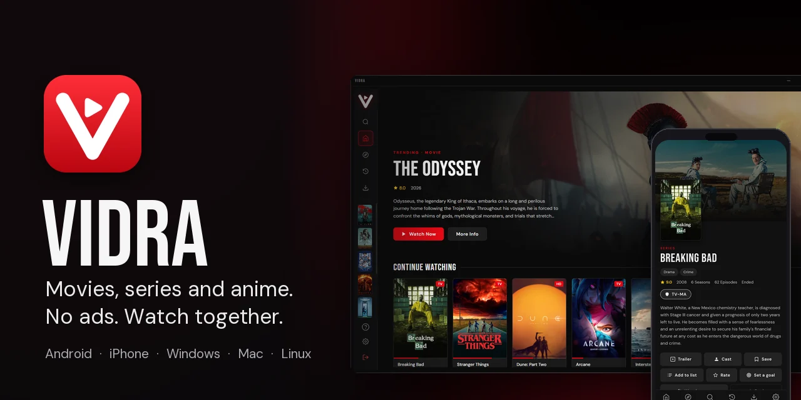
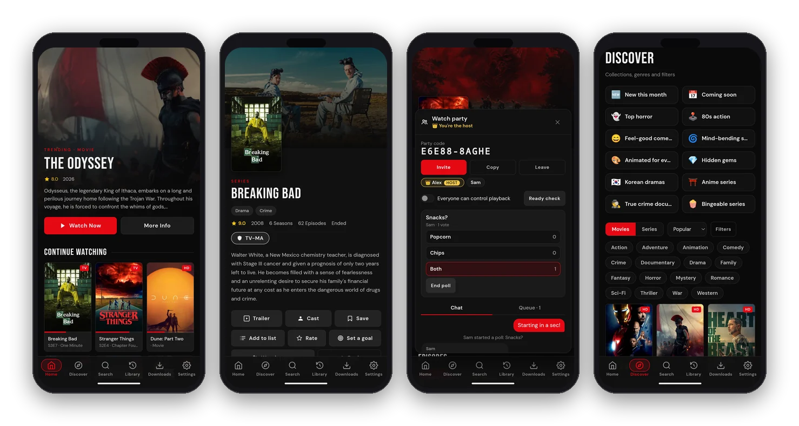
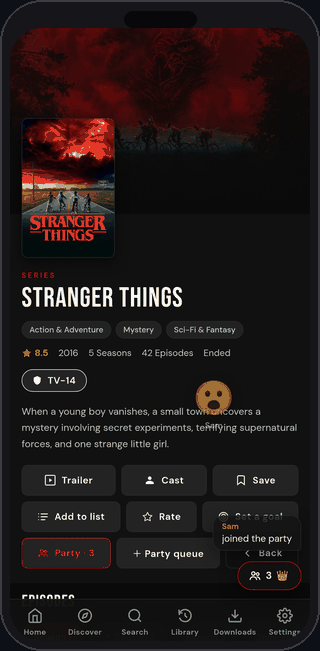
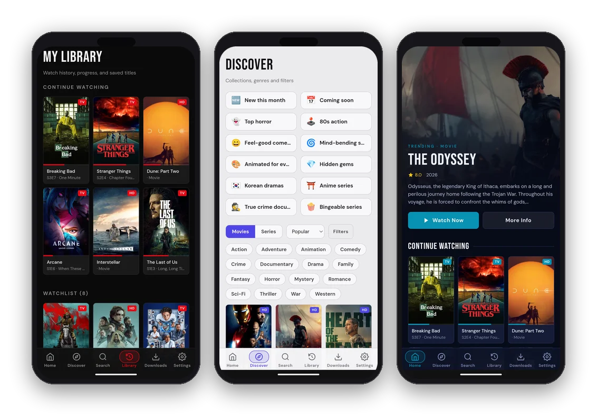

<p align="center">
  
</p>

<p align="center">
  <a href="https://github.com/SoloHandCoder/vidra-ios/releases/latest"></a>
  <a href="https://github.com/SoloHandCoder/vidra-ios/actions/workflows/ios.yml"></a>
  
  <a href="LICENSE"></a>
</p>

<p align="center">
  <a href="https://github.com/SoloHandCoder/vidra-ios/releases/latest"></a>
</p>

<p align="center">
  Also on <a href="https://github.com/SoloHandCoder/vidra-android"><b>Android</b></a> and <a href="https://github.com/SoloHandCoder/vidra-desktop"><b>Windows</b></a>. Your library syncs between all of them.
</p>

<p align="center">
  
</p>

> [!NOTE]
> The screenshots above are from the Android app; the iPhone app is the same app and looks the same.

## ✨ What you get

<table>
<tr>
<td width="50%" valign="top">

**🎬 Everything in one place**<br>
Movies, series and anime with posters, trailers, cast and ratings. "Because you watched…" rows and a Discover page with collections, genres and filters.

**👥 Watch parties**<br>
Play, pause and skipping stay in sync with friends on iPhone, Android and Windows. Chat, emoji reactions, a host, a ready check with a 3‑2‑1 countdown, a shared queue and polls. End‑to‑end encrypted.

**⏭️ Up next**<br>
When the credits roll, the next episode starts after a short countdown, and the one you finished is marked as watched.

</td>
<td width="50%" valign="top">

**☁️ Sync and profiles**<br>
Watchlist, progress, ratings and lists sync with your other devices. Everyone gets a profile; kids profiles have an age limit, and Face ID can lock the app.

**🎨 Make it yours**<br>
Eleven themes from AMOLED black to Sepia, an Auto mode that follows your iPhone, any accent colour, and six app languages.

**🔔 Never miss an episode**<br>
Release reminders as iPhone notifications, following actors and directors, watch‑time goals and a yearly recap card to share.

</td>
</tr>
</table>

## 🎉 Watch together

<table>
<tr>
<td width="38%" align="center"></td>
<td valign="middle">

1. Open a movie or show and tap **Watch party → Start a party**.
2. Tap **Invite** and send the link, or just the code.
3. Watch in sync. Messages pop up over the video, so you don't need the chat open.

**The host** decides who controls playback, runs a **ready check** so everyone starts together, keeps the **queue** of what's next and can start a **poll** about it.

</td>
</tr>
</table>

## 🎨 Themes

<p align="center">
  
</p>

## 📲 Install

Vidra isn't on the App Store. Each [release](https://github.com/SoloHandCoder/vidra-ios/releases/latest) has an **unsigned `.ipa`** that you install with a sideloading tool, which signs it with your own Apple ID:

- **[AltStore](https://altstore.io)** or **[SideStore](https://sidestore.io)** on the iPhone, or
- **[Sideloadly](https://sideloadly.io)** from a computer.

With a free Apple ID, apps need to be re-signed every 7 days; AltStore and SideStore can do that automatically.

On first start, paste your free **TMDB read access token** ([how to get one](https://github.com/SoloHandCoder/vidra-desktop/blob/main/tmdb-tutorial.md)).

**Updates:** Settings → Check for updates finds new releases here. iOS doesn't let apps install other apps, so "Install" opens the release page; install the new `.ipa` the same way. Your data is kept.

## 🧭 What's different on iPhone

- **Downloads** work like on Android: pick a quality, download single episodes or whole seasons, pause and continue, Wi-Fi only if you like. Downloads continue while Vidra is open; when you leave the app they pause after a short while and continue when you come back. They're kept in Vidra's own storage (also visible in the Files app under On My iPhone → Vidra → Downloads) and play in iOS's own video player, with subtitles and where you left off.
- **Not available yet:** Chromecast, home-screen widgets, background new-episode checks and voice search.
- Fullscreen and picture-in-picture use iOS's own video player.

## ❓ FAQ

<details>
<summary><b>Is it free? Are there ads?</b></summary>

Free and open source. There are no ads in the app, and ad and tracker requests from the video sources are blocked with a built-in content blocker.
</details>

<details>
<summary><b>Why isn't it on the App Store?</b></summary>

It plays streams from third-party websites, which the App Store doesn't allow. Sideloading with your own Apple ID works on any iPhone.
</details>

<details>
<summary><b>How does sync work?</b></summary>

Settings → Profiles &amp; Privacy → Cloud sync. Your data goes into a private GitHub Gist under your own account (the token only needs the <code>gist</code> permission). There's no Vidra server.
</details>

## 🛠️ For developers

<details>
<summary><b>How it works</b></summary>

- **UI**: the shared React app (`src/`), the same as on Android.
- **`window.electron` shim** (`src/mobile/electronShim.js`) maps the desktop preload API to the native plugin.
- **Native layer** (`ios/App/App/`):
  - `StreambertPlugin.swift`: the app's Capacitor plugin (still registered under its original name, `Streambert`). Native HTTP (no CORS), files, notifications and reminders, sharing, Face ID app lock, keep-screen-on and brightness, cache and cookies, links opened with the app, and updates.
  - **Frame script**: `public/native/sb-inject.js` is injected into every frame (WKUserScript). It provides `executeJavaScript` for embedded players and stubs pop-ups.
  - **Ad blocking**: the shared block list (`public/native/sb-blocklist.txt`) is compiled into a WebKit content blocker.
  - **Navigation**: embedded players can't navigate the whole app away to ad pages.
  - `Downloads.swift`: the native HLS / file downloader (best variant, AES-128 keys and init segments, 6 parallel requests, a local `index.m3u8`, pause / resume, a registry that survives restarts, `downloadProgress` events).
  - `LocalPlayer.swift`: plays downloads in `AVPlayerViewController`; downloaded HLS folders are served to it by a small HTTP server on `127.0.0.1`.
  - `MainViewController.swift` registers the plugin.
</details>

<details>
<summary><b>Build</b></summary>

GitHub Actions (`.github/workflows/ios.yml`) builds an unsigned `.ipa` on every push; it's in the run's artifacts. Pushing a tag `vX.Y.Z-ios` also publishes a release, with notes from `release-notes/<tag>.md` if that file exists.

Local build (needs a Mac with Xcode 16 and CocoaPods):
```bash
npm install
npm run build
npx cap sync ios
open ios/App/App.xcworkspace
```
</details>

## 💛 Credits

Vidra is based on **[Streambert](https://github.com/truelockmc/streambert)** by truelockmc. All credit for the original app goes to them. Movie and show data comes from [TMDB](https://www.themoviedb.org/); Vidra isn't endorsed or certified by TMDB.

## ⚖️ Legal

Vidra is for personal and educational use. It doesn't host, store or distribute any content: it shows information from TMDB and plays what third-party websites provide. You are responsible for making sure you're allowed to watch what you open. Please support creators through legal services.

Licensed under the [GPL-3.0](LICENSE). Forks must stay open source.
